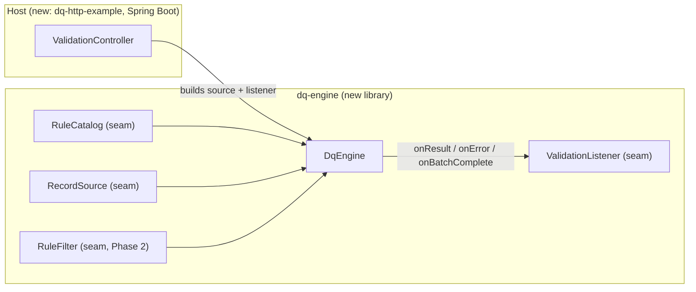
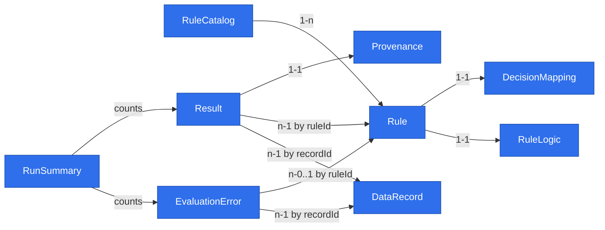

# Data-Quality Rule Engine — embeddable Java library

> Source requirements: `DQ Team Lead task.md` (F1–F6, fixtures §5, deliverables §6).
> Reviewer-facing rationale goes in `DESIGN.md` at the repo root; this file is the build plan and the contract.

## 📝 TLDR
An HTTP API, batch workers, and scheduled jobs all need to validate business-partner master data. Today there is no shared code for this. The proposal (future behavior) is a Java 25 library, `dq-engine`. It runs a catalog of rules over a stream of JSON records. Each rule computes a string **value** in Java, and a **decision mapping** stored as data turns that value into a `Decision`. Every outcome goes to a caller-supplied listener as a `Result` with provenance, or as an `EvaluationError`. The run then returns a `RunSummary`. Delivery has two phases. **Phase 1 (F1–F4)** passes the §5 fixtures and shows fault isolation. **Phase 2 (F5–F6)** adds streaming input with bounded memory for about 1M records, a configurable batch size, and composable rule filters. A Spring Boot example host exposes both phases.

### Resolved decisions (from the Open Questions gate)
| # | Decision |
|---|---|
| Q1 | One spec, two phases. The listener-based API ships in Phase 1, so Phase 2 only *adds* to it. |
| Q2 | Rule **logic is Java** (`RuleLogic`). Rule **definitions** (id, label, metadata, mapping) are data. Logic is referenced by a registered name when a definition comes from a file (Phase 2 stretch). |
| Q3 | **Push API**: `engine.validate(source, listener[, options]) → RunSummary`. |
| Q4 | **Sequential** evaluation. Parallel batches are written down as the next step. Listener callbacks come from a single thread, in order. |
| Q5 | A rule outside the record's country scope **emits `NOT_APPLICABLE`**. Its provenance reason is `OUT_OF_SCOPE`, and the logic is not run. |
| Q6 | The example host is **Spring Boot**: plain JSON in Phase 1, plus **NDJSON streaming** in Phase 2. |
| Q7 | The spec lives in `docs/specs/`. |

## 📝 Problem Statement
- Several hosts embed the validation, so it must be a **library**. That means no global state, no framework in the core, a small public API that can be versioned, and seams the host can supply for the rule catalog, the record input, and where results go.
- Correctness is defined by the §5 fixture table, which is the Phase 1 acceptance test. Fault isolation must be *shown by a test*, not just claimed.
- At about 1,000,000 records × dozens of rules, a run produces tens of millions of outcomes. So `List<Result>` cannot be the primary API (F5). Memory has to depend on the batch size, not on the run size.

### Assumptions
- **A1 — Missing vs. failing field.** `r3` has no `vatId` and is expected to be `INVALID`. So an *absent* field is a normal input that the logic handles through `Optional`. An **error** means one of: the logic throws, a type mismatch, a **required** field is missing (`fields.require(...)`), or the logic returns `null`.
- **A2** — A rule with no country scope means `WORLD`. A record with no `country` is out of scope for every rule scoped to a country, which gives `NOT_APPLICABLE / OUT_OF_SCOPE`.
- **A3** — The record id is read from a configurable field (default `id`). If it is missing, the engine uses the positional id `#<index>`. Every Result and error also carries the 0-based record index.
- **A4** — An unmapped value goes to `default` when one is defined. When there is no default (as in the fixture's `vatFormat`/`ibanFormat`), the engine records an `EvaluationError(UNMAPPED_VALUE)` and never picks a decision on its own.
- **A5** — An invalid catalog fails at **engine build time** with `InvalidCatalogException`, before any record runs. Invalid means duplicate ids, a blank id or label, an empty mapping, or an unknown logic name. This is a configuration error, not a per-record one.
- **A6** — Whatever filter the caller passes, the engine always adds `status == RELEASED` to it (F6). A filter that selects no RELEASED rules is a valid run with `rulesSelected = 0`, not an exception.
- **A7** — F6 asks for two kinds of country filtering, and the engine has both. (1) The **per-record scope check** always runs (see Q5). (2) `RuleFilter.countryScope(countries…)` is an optional **run-level** selection, for example a worker that runs only DE rules: it keeps rules whose scope is `WORLD` or one of the given countries.

## 📝 Proposed Solution
A single, framework-free evaluation loop:

`RecordSource` → (for each record × selected rule) scope check → `RuleLogic` reads fields through a `FieldReader` that records what was read → `DecisionMapping.resolve(value)` → `Result` or `EvaluationError` → `ValidationListener` → counters → `RunSummary`.

- **The mapping is data:** `DecisionMapping` is an immutable `Map<String, Decision>` plus an optional `default`. Rule code returns a value and has no access to `Decision` or the mapping, so a rule's code cannot decide the outcome itself (F2). The rule's type signature enforces this.
- **Fault isolation:** each (rule × record) evaluation sits inside its own `try/catch`. A record that cannot be read becomes a record-level error. Only problems the host owns can stop a run: a listener exception, cancellation, or a fatal input-stream error.
- **Bounded memory:** the engine pulls up to `batchSize` records from a streaming source into a buffer. It evaluates them, pushes each outcome straight to the listener, calls `onBatchComplete`, and then drops the buffer. Live heap is therefore O(`batchSize` records plus the outcomes of a single evaluation), whatever the input size. The batch is also the unit a host commits on, and the unit future parallelism will split on.

### Alternatives considered
| Option | Why it lost |
|---|---|
| `List<Result>`-returning API, with streaming added later | Phase 2 would have to break the API, and the obvious first call would also be the wrong one at scale. A `CollectingListener` covers the small-batch case. |
| `Stream<Outcome>` pull API (Q3b) | The summary needs a side channel, and resource and exception semantics are awkward when a stream is consumed lazily inside a host. Still possible later as an adapter on top of the push core. |
| Rule engine (Drools / Easy Rules) | These are built for inference/RETE, which we do not need. They are heavy dependencies for a library, and they push the decision back into rule code. |
| Expression language for logic (CEL/JEXL) | Deferred (next step). Logic as data is valuable, but it brings a sandbox, a type system, and error reporting that do not fit the time-box. The `RuleLogic` seam leaves room for a `CelRuleLogic` later. |
| Jackson types in the public API | This would tie every host to a Jackson version. Jackson stays an `implementation` dependency, and records cross the API as `Map<String, Object>`. |

## 📝 Research — market leaders
- **Great Expectations / Soda Core:** checks are declared as data, and every run returns *results plus summary statistics*. → We adopt the result + summary split. We skip dataset-level metrics and `mostly` thresholds, because our rules are per record.
- **AWS Deequ:** column-level metrics computed on Spark. → This confirms that record-level evaluation with streaming is a different niche, so we do not compute aggregates beyond counters.
- **Jakarta Bean Validation:** a `ConstraintViolation` carries the property path and the invalid value, and *groups* select constraints. → Our provenance (fields read → values) and categories are the same ideas. We borrow the "violation explains itself" standard.
- **Easy Rules:** has a `RuleListener` with `onSuccess`/`onFailure`. → This validates the listener shape. We skip its rule-composition features.
- **What they all carry that we skip:** rule authoring UIs, persistence of results, and profiling. These belong to the hosts.

## 📝 Delta

### Capability: dq-rule-evaluation

#### ADDED Requirement: One Result per applicable rule and record
The engine SHALL emit exactly one `Result` or one `EvaluationError` for each (selected rule × readable record) pair. Each Result carries the decision, the rule's severity, and provenance: rule id and label, record id and index, the fields read with their values, the computed value, and how the decision was reached (`MAPPED` / `DEFAULT` / `OUT_OF_SCOPE`).

##### Scenario: §5 fixture
- WHEN the §5 records r1–r3 are validated against `countryBlocked`, `vatFormat`, and `ibanFormat`
- THEN 9 Results match the §5 expected table, and `r2/vatFormat` has `fieldsRead = {vatId: "FR22"}`, `value = "bad"`, `INVALID`

#### ADDED Requirement: Decision through a declarative mapping
The engine SHALL derive every decision by looking up the rule's computed value in its `DecisionMapping`, falling back to `default` when the value is not mapped.

##### Scenario: Default fallback
- WHEN `countryBlocked` computes `"ok"` and the mapping has only `blocked→INVALID, default→NOT_APPLICABLE`
- THEN the Result is `NOT_APPLICABLE` with provenance `DEFAULT`

##### Scenario: Unmapped value without default
- WHEN a rule computes a value that is not in its mapping and the mapping has no default
- THEN an `EvaluationError(UNMAPPED_VALUE)` names the rule, the record, and the value, and no Result is emitted

#### ADDED Requirement: Country scope applicability
The engine SHALL emit `NOT_APPLICABLE` with provenance `OUT_OF_SCOPE`, without running the logic, when a rule's scope is a country other than the record's country.

##### Scenario: Scoped rule on a foreign record
- WHEN a rule scoped to `DE` meets record r2 (`FR`)
- THEN the Result is `NOT_APPLICABLE / OUT_OF_SCOPE`, and the logic is not called

#### ADDED Requirement: Fault isolation
The engine SHALL record an `EvaluationError` (rule id, record id and index, kind, message, cause type, fields read so far) when a rule throws, reads a missing required field, hits a type mismatch, or returns null. It SHALL record an `UNREADABLE_RECORD` error when a record is not a JSON object. In both cases the run continues.

##### Scenario: Throwing rule
- WHEN a fourth rule `faulty` (computes `"ok"`, mapping `ok→VALID`, throws for r2) is added to the fixture catalog
- THEN the run completes with 11 Results (the 9 fixture Results plus `faulty` VALID for r1 and r3) and 1 `RULE_EXCEPTION` error naming `faulty` and `r2`

##### Scenario: Non-object element
- WHEN the input array contains `42` between r1 and r2
- THEN 1 `UNREADABLE_RECORD` error at index 1 is recorded, r1–r3 still yield the 9 fixture Results, and `recordsRead = 4` (unreadable elements count as read)

#### ADDED Requirement: Host failures abort the run
The engine SHALL stop the run and throw `ValidationRunException` (carrying the partial `RunSummary`) when the listener throws or the input stream is syntactically broken. Results already emitted stay emitted.

##### Scenario: Listener throws
- WHEN the listener throws on the 2nd Result
- THEN `validate` throws `ValidationRunException` whose partial summary has `resultCount = 1`, because an outcome is counted only after its listener call returns normally

#### ADDED Requirement: Run summary
`validate` SHALL return a `RunSummary` with records read, rules selected, result count, error count, a count per `Decision`, a count of findings (`INVALID` and `REVIEW` results) per `Severity` (every enum key present, zeros included), the duration, and a completion status.

##### Scenario: Fixture summary
- WHEN the §5 fixture runs, with severities `countryBlocked=ERROR`, `vatFormat=ERROR`, `ibanFormat=WARNING`
- THEN results=9, errors=0, `VALID=3, INVALID=4, REVIEW=0, NOT_APPLICABLE=2`, `ERROR=3, WARNING=1, INFO=0`

#### ADDED Requirement: Bounded-memory streaming (Phase 2)
The engine SHALL process a streamed JSON input of any length with heap use bounded by `batchSize`, not by the input size, delivering each outcome to the listener as it is produced. After each batch it SHALL call `onBatchComplete`.

##### Scenario: One million records
- WHEN 1,000,000 generated records, streamed as a JSON array through `RecordSources.jsonArray`, run against 3 rules with `-Xmx64m` and a counting listener
- THEN the run completes with results + errors = 3,000,000 and no `OutOfMemoryError`

##### Scenario: Batch size
- WHEN 2,500 records run with `batchSize = 1000`
- THEN `onBatchComplete` is called 3 times, with sizes 1000, 1000, 500

#### ADDED Requirement: Cancellation (Phase 2, optional)
The engine SHALL stop between records when the calling thread is interrupted, and return a summary with status `CANCELLED`.

##### Scenario: Interrupt mid-run
- WHEN the thread is interrupted after the first batch
- THEN `validate` returns with status `CANCELLED`, and the summary counts only what was emitted

### Capability: dq-rule-selection

#### ADDED Requirement: Composable rule filters (Phase 2)
The engine SHALL select rules with a `RuleFilter` built from `status(..)`, `countryScope(..)`, and `category(..)`, combined with `and`/`or`/`not`. It SHALL always intersect the result with `status == RELEASED`.

##### Scenario: Category and country
- WHEN the filter is `category("tax").and(countryScope("DE"))`
- THEN only RELEASED rules that are in category `tax` and scoped to `WORLD` or `DE` run

##### Scenario: Non-released rules never run
- WHEN the filter is `status(DRAFT)`
- THEN `rulesSelected = 0`, no Results are emitted, and the run completes normally

## 📝 Architecture


The library depends on nothing from the host. Every input and output crosses one of four interfaces the host can implement.

**Modules (Gradle multi-project, Kotlin DSL, Java 25 toolchain):**
- `dq-engine`: a `java-library` with JPMS `module-info`. It exports `…dq.engine.api` only. `…dq.engine.internal` (the evaluation loop, JSON parsing, counters) stays hidden. Its dependencies are `jackson-core` and `jackson-databind`, declared as `implementation` so they are not part of the API. Logging goes through `System.Logger`, so the library adds no logging framework.
- `dq-http-example`: a Spring Boot application that depends on `dq-engine`. Its `main` source has an `ExampleCatalog` with the three §5 rules. The library's tests keep their own copy in `src/testFixtures`, because the library must not depend on the example and test code must not ship in the app. Duplicating three small rules is the cheaper trade.
- Test stack: JUnit 5 and AssertJ. Phase 2 adds a separate `scaleTest` Gradle task with its own heap cap.

**Library qualities (the non-functional requirements left out of the brief):**
- **Immutability and thread-safety:** `DqEngine`, `Rule`, and `DecisionMapping` are immutable. One engine instance can serve concurrent runs, with each run's state kept on that run's call stack.
- **No hidden state:** no statics, singletons, or service loaders are required. A host passes everything explicitly.
- **Fail-fast configuration:** the catalog is validated at `build()`. At run time, problems are isolated per record (A5 versus F3).
- **Stable surface:** a small exported package, records and sealed types, `Objects.requireNonNull` on every API entry, Javadoc on the API package, and a written semver policy in `DESIGN.md`.
- **Determinism:** rules run in catalog order and records in input order, so output order is stable for a given input. This matters for tests and diffs.

**Seams the host can supply:**
| Seam | Built-in implementations | Host examples |
|---|---|---|
| `RuleCatalog` | `RuleCatalog.of(rules…)`; Phase 2 stretch: `JsonRuleCatalog` + `LogicRegistry` | DB-backed catalog, versioned catalog service |
| `RecordSource` | `RecordSources.of(List<Map>)`, `RecordSources.jsonArray(InputStream)` (streaming in Phase 2) | Kafka consumer, JDBC cursor, S3 object |
| `ValidationListener` | `CollectingListener` (small batches), `CountingListener` (tests/metrics) | DB batch writer, NDJSON writer, metrics bridge |
| `RuleFilter` (P2) | `status`, `countryScope`, `category`, `all`, with `and`/`or`/`not` | Tenant- or job-specific selection |
| Field names | `recordIdField`, `countryField` on the engine builder | Different record schemas |

## 📝 Data Model
All types are immutable Java records, enums, or sealed interfaces in `…dq.engine.api`.

| Type | Fields / shape | Notes |
|---|---|---|
| `Rule` | `id`, `label`, `RuleLogic logic`, `DecisionMapping mapping`, `RuleStatus status`, `Severity severity`, `CountryScope scope`, `Set<String> categories` | Created through `Rule.builder()`, which validates its input; `scope` defaults to `WORLD`. |
| `RuleLogic` | `@FunctionalInterface String compute(FieldReader fields)` | Returns a value only and never sees `Decision` (F2). |
| `FieldReader` | `Optional<String> text(name)`, `String require(name)`, `Optional<Object> raw(name)`, `boolean has(name)` | Records every name it reads, and the value found or `<absent>`, in read order for provenance. A non-string value passed to `text` raises `TYPE_MISMATCH`. |
| `DecisionMapping` | `Map<String, Decision> cases`, `Optional<Decision> defaultDecision` | `resolve(value)` returns `Mapped(decision)`, `Defaulted(decision)`, or `Unmapped`. |
| `CountryScope` | sealed: `World` \| `Country(String iso2)` | `appliesTo(recordCountry)` |
| `DataRecord` | `id`, `index`, `Map<String,Object> fields` (unmodifiable) | The id comes from `recordIdField`, falling back to `#index` (A3). |
| `Result` | `ruleId`, `recordId`, `Decision decision`, `Severity severity`, `Provenance provenance` | |
| `Provenance` | `ruleId`, `ruleLabel`, `recordId`, `recordIndex`, `SequencedMap<String,Object> fieldsRead`, `String computedValue` (null when `OUT_OF_SCOPE`), `Basis basis` (`MAPPED`/`DEFAULT`/`OUT_OF_SCOPE`) | |
| `EvaluationError` | `Optional<String> ruleId` (empty for record-level), `recordId`, `recordIndex`, `ErrorKind kind`, `message`, `causeType`, `fieldsRead`, `Throwable cause` (nullable; excluded from serialized output) | `ErrorKind` (enum): `RULE_EXCEPTION`, `MISSING_REQUIRED_FIELD`, `TYPE_MISMATCH`, `NULL_VALUE`, `UNMAPPED_VALUE`, `UNREADABLE_RECORD` |
| `RunSummary` (complete shape from Phase 1) | `recordsRead`, `rulesSelected`, `resultCount`, `errorCount`, `Map<Decision,Long> byDecision`, `Map<Severity,Long> bySeverity`, `Duration duration`, `RunStatus status` (`COMPLETED`/`CANCELLED`/`ABORTED`) | Maps are `EnumMap`s with every key present. |
| `RunOptions` (P2) | `int batchSize` (default 1000, ≥ 1), `RuleFilter filter` (default `all()`) | |
| `BatchProgress` (P2) | `batchNumber`, `recordsInBatch`, `recordsSoFar` | Passed to `onBatchComplete`. |


Nothing is persisted. Results refer to rules and records **by id**, never by object, so a listener that keeps them does not keep records alive.
**Sensitive data:** VAT ids and IBANs appear in `fieldsRead`. The library never logs field values; only the ids, the kind, and the cause type reach `System.Logger`. Hosts decide whether provenance values are stored or returned.

## 📝 API Contracts

### Library
```java
DqEngine engine = DqEngine.builder()
    .catalog(RuleCatalog.of(countryBlocked, vatFormat, ibanFormat))
    .recordIdField("id").countryField("country")        // optional, these are the defaults
    .build();                                           // throws InvalidCatalogException

RunSummary s = engine.validate(RecordSources.jsonArray(in), listener);              // Phase 1
RunSummary s = engine.validate(source, listener, RunOptions.builder()               // Phase 2 (additive)
    .batchSize(5_000).filter(RuleFilter.category("tax").and(RuleFilter.countryScope("DE"))).build());

interface ValidationListener {
    void onResult(Result r);
    void onError(EvaluationError e);
    default void onBatchComplete(BatchProgress p) {}      // Phase 2: flush / commit point for hosts
}
```
- Callbacks run on the calling thread, in order (Q4). Listeners do not need to be thread-safe.
- `validate` closes the `RecordSource` it was given (try-with-resources). A source made by `jsonArray(InputStream)` owns that stream and closes it as well.
- Exceptions: `InvalidCatalogException` (build time), `ValidationRunException` (a listener or source failure that aborts the run, carrying the partial summary), and `IllegalArgumentException` / `NullPointerException` for misuse of the API.

### HTTP example (`dq-http-example`)
- `POST /validations`, `Content-Type: application/json`, body is a JSON array of records.
  - Phase 1: `200 {summary, records[]}`, one entry per input record: `{recordId, results: {ruleId → {decision, severity (only for INVALID and REVIEW), provenance (the rule's explanation, e.g. `len 4 instead of 9`, else its label)}}, errors[]}`, with results in catalog order. Bodies over `dq.http.max-records` (default 10,000) get `413` with a hint to use NDJSON. Invalid JSON gets `400` with a problem-detail body.
  - Phase 2, `Accept: application/x-ndjson`: the response streams one line per record (`{"type":"record",…}`, the same shape as a `records[]` entry) and ends with `{"type":"summary",…}`. If the run aborts after the response has started, the last line is `{"type":"aborted","reason":…}`, because the status code has already been sent.
  - Phase 2 query parameters: `status`, `country`, `category` (repeatable, ANDed across kinds and ORed within a kind), and `batchSize`.

## 📝 Edge Cases & Failure Scenarios
| Case | Behavior |
|---|---|
| Rule throws, or a required field is missing | `EvaluationError` for that pair; other rules on the same record still run. |
| Logic returns `null` | `EvaluationError(NULL_VALUE)` |
| Unmapped value with no default | `EvaluationError(UNMAPPED_VALUE)`, with the value in the message |
| Array element is not an object | `EvaluationError(UNREADABLE_RECORD)`, `ruleId` empty; the next element is processed. |
| JSON syntax error | Parsing starts inside `validate`, never when the source is created, in both phases. The array parser cannot resynchronize, so the run aborts with `ValidationRunException` and a partial summary. NDJSON input, which could resynchronize line by line, is a next step. |
| Duplicate record ids | Allowed; `recordIndex` tells them apart. Detecting duplicates is the host's job. |
| Record missing `id` / `country` | `#index` id (A3); country-scoped rules give `OUT_OF_SCOPE` (A2). |
| Listener throws | The run aborts (`ABORTED`). Silently dropping outcomes would break the "caller receives everything" promise. |
| Rule loops forever | **Not handled:** sequential evaluation has no per-rule timeout. This needs a worker thread per evaluation (next step). Documented as a limitation. |
| Errors thrown inside a rule | The isolation boundary catches `Exception`, `StackOverflowError` (checked first, even though it is a `VirtualMachineError`), and `LinkageError`, and reports them as `RULE_EXCEPTION`. Every other `Error` (for example `OutOfMemoryError`) propagates, because it is not isolatable. |
| Empty input or empty catalog selection | A `COMPLETED` summary with zero counts. |

## 📝 Risks & Impact Review
- **Public API is a durable contract.** The listener + summary shape and the sealed `ErrorKind` are hard to change once hosts depend on them. To keep options open, the `ErrorKind` enum is documented as *open for additions*: hosts must use a `default` branch in switches over it. `RunSummary` ships with its full shape in Phase 1, because adding a component to a record breaks its constructor. Phase 2 changes are additive overloads only.
- **Volume of `NOT_APPLICABLE` results (Q5b).** Country-scoped catalogs emit one Result per (record × foreign rule). That inflates output and storage for hosts. The mitigation is `RuleFilter.countryScope` for jobs that run per country. A run option to suppress `OUT_OF_SCOPE` Results could be added later without breaking anything.
- **String-typed values.** `RuleLogic` returns `String`, which keeps mapping keys simple and serializable but means numeric or enum values have to be converted to strings. This is reversible only through a new `RuleLogic` variant.
- **Single-country scope.** The brief says "optional country scope". `CountryScope` is sealed, so a `Countries(Set)` variant can be added later; that is a source-compatible change for pattern matches that have a default branch.
- **Jackson dependency.** It is the library's only dependency and it stays internal, so a host's own Jackson version could conflict at runtime only. Shading it is a next step if hosts report conflicts.

## 📋 Phasing
- **Phase 1 — Core (F1–F4):** the domain model, the mapping, the evaluation loop, fault isolation, the full `RunSummary`, a JSON array source, `CollectingListener`, the Spring Boot plain-JSON endpoint, and the first `DESIGN.md`. It can ship on its own: it passes §5 and the fault-isolation demo.
- **Phase 2 — Extended (F5–F6):** the streaming JSON source, `RunOptions` (batch size), batch callbacks, a 1M-record scale test under a heap cap that runs in `check`, the composable `RuleFilter`, the NDJSON endpoint, the final `DESIGN.md`, and the Delta archived into the capability specs.
- **Optional (only if time allows; the slice is complete without them):** interrupt-based cancellation, and the `JsonRuleCatalog` loader.

## 📋 Implementation Plan
Each Step is one commit, and `./gradlew build` passes after every Step. Docs-only Steps are marked *(docs)* and are checked by review, not by a test.

### Phase 1 — Core
1. **Repo and build skeleton.** Create the GitHub repo, `settings.gradle.kts` with the `dq-engine` module only, the Java 25 toolchain, a version catalog, JUnit 5 and AssertJ, `.gitignore`, and a README stub. There is no `module-info` yet. *Test:* one smoke test; `./gradlew build` passes.
2. **Value types and the mapping, plus `module-info`.** `Decision`, `Severity`, `RuleStatus`, `CountryScope`, and `DecisionMapping.resolve`. "Empty mapping" means no cases and no default, and it is rejected; a mapping with only a default is valid. `module-info` exports `…dq.engine.api`, which now has content. *Tests:* a parameterized table for mapped, defaulted, and unmapped values; the empty-mapping rejection.
3. **Records and `FieldReader`.** `DataRecord`, with the `#index` id fallback, and a tracking `FieldReader` (`text`/`require`/`raw`, read order, `<absent>`). *Tests:* read-tracking order, `TYPE_MISMATCH`, `MISSING_REQUIRED_FIELD`, id fallback.
4. **`Rule`, `RuleCatalog`, catalog validation.** The builder, `RuleCatalog.of`, and `InvalidCatalogException`. *Tests:* one per rejection: duplicate id, blank id, blank label, empty mapping.
5. **Evaluation loop, `RunSummary`, and the fixture acceptance test.** `DqEngine.builder()`, `validate(source, listener)`, `RecordSources.of(List<Map>)`, the scope check (`OUT_OF_SCOPE`), RELEASED-only, `Result` with `Provenance`, `CollectingListener`, and the **complete** `RunSummary` (all fields in the Data Model, including `rulesSelected`, which here counts the RELEASED rules). An outcome is counted only after its listener call returns. The fixture rules go in `src/testFixtures`. *Tests:* `FixtureScenarioTest` covers the 9 cells of §5, the provenance of `r2/vatFormat`, and the fixture summary (9 / 0 / VALID 3, INVALID 4, REVIEW 0, NOT_APPLICABLE 2 / ERROR 6, WARNING 3, INFO 0).
6. **Fault isolation.** One `try/catch` per evaluation with the precedence set out in the Edge Cases table, the `ErrorKind` mapping, and `ValidationRunException` with a partial summary when the listener fails. *Tests:* `FaultIsolationTest` covers the `faulty` rule scenario (11 Results + 1 error), a `null` value, an unmapped value with no default, a missing required field, a rule that throws `StackOverflowError` (isolated), and a listener that throws on the 2nd Result (`ABORTED`, `resultCount = 1`).
7. **JSON input.** `RecordSources.jsonArray(InputStream)`. It is parsed lazily inside `validate` and reads the whole array in this phase. Non-object elements become `UNREADABLE_RECORD`, a syntax error becomes `ValidationRunException`, and the source closes its stream. *Tests:* the fixture from a JSON resource, the `42` element (`recordsRead = 4`), malformed JSON (`ABORTED`), and that the stream is closed.
8. **HTTP example, Phase 1.** Add the `dq-http-example` module: a Spring Boot app, `ExampleCatalog` in `main` (the three §5 rules; `ibanFormat` reads `country` through `require`), `POST /validations` returning JSON, the 413 limit, and a 400 problem detail. *Tests:* MockMvc tests for the fixture (9 Results), the **fault demo** (fixture plus `{"id":"r4","iban":"DE1"}` plus `42` gives 11 Results, from r4's `countryBlocked` NOT_APPLICABLE and `vatFormat` INVALID, and 2 errors: r4 `ibanFormat` `MISSING_REQUIRED_FIELD` and `UNREADABLE_RECORD` at index 4), 400, and 413.
9. *(docs)* **`DESIGN.md` (Phase 1 sections) and README run instructions** (`./gradlew test`, `./gradlew :dq-http-example:bootRun`, a sample `curl` for the fixture and the fault demo).

### Phase 2 — Extended
10. **Streaming JSON source.** Rewrite `jsonArray` on top of Jackson's `JsonParser`, reading one object tree at a time; the API does not change. *Tests:* every Step 7 test still passes unchanged; a truncated array aborts with the counts emitted so far.
11. **`RunOptions` and batches.** A new `RunOptions` type, the additive `validate(…, RunOptions)` overload, `batchSize` validation (≥ 1), the buffer-evaluate-emit-drop batch loop, and `onBatchComplete`. *Tests:* 2,500 records with `batchSize = 1000` give batch callbacks of 1000, 1000, and 500; `batchSize = 0` is rejected.
12. **Bounded-memory proof through the real input path.** A test-only `InputStream` that generates 1M JSON records lazily, fed through `RecordSources.jsonArray` into a counting listener. A `scaleTest` Gradle task runs it with `maxHeapSize = "64m"`, and `check` depends on it so CI runs it. *Test:* the run completes with results + errors = 3,000,000 and no OOM; the test logs throughput, which is not a summary field.
13. **`RuleFilter`.** The factories, `and`/`or`/`not`, and the RELEASED intersection in the engine. *Tests:* each factory, the combinations, the `status(DRAFT)` scenario (`rulesSelected = 0`), and `countryScope("DE")` keeping a WORLD rule.
14. **NDJSON streaming endpoint.** `StreamingResponseBody` with the streaming source, filter query parameters, and the `aborted` trailer line. *Tests:* a MockMvc async test on NDJSON line order and the final `summary` line; a `category` parameter lowers `rulesSelected`; truncated input ends with an `aborted` line.
15. *(optional)* **Cancellation.** An interrupt check between records, giving `CANCELLED`. *Test:* interrupt from `onBatchComplete` after batch 1; the summary counts only batch 1.
16. *(optional)* **`JsonRuleCatalog` + `LogicRegistry`.** Rule definitions loaded from JSON with logic resolved by name; an unknown name gives `InvalidCatalogException`. *Test:* the fixture catalog loaded from JSON gives results identical to `FixtureScenarioTest`.
17. *(docs)* **`DESIGN.md` final.** Fault isolation, bounded memory, seams, the semver policy, trade-offs, and next steps: parallel batches on virtual threads, per-rule timeouts, CEL logic, NDJSON input, a rule version or hash in provenance, an option to suppress `OUT_OF_SCOPE` Results, multi-country scope, and Maven publication. Every claim points to a test or a class.
18. *(docs)* **Archive the Delta** into `docs/specs/capabilities/dq-rule-evaluation.md` and `docs/specs/capabilities/dq-rule-selection.md`, using the capability file shape with `Source: docs/specs/2026-11-20-dq-rule-engine.md`.

## 📋 Implementation status (2026-11-23)
Steps 1–15, 17 and 18 are implemented, one commit per Step on `feat/dq-rule-engine`. Step 16 (`JsonRuleCatalog` + `LogicRegistry`) is optional and was not built; it is listed as a next step in `DESIGN.md`. Deviations from this plan:
- Step 1: the GitHub repository already existed.
- Step 3: there is no public `DataRecord`. The engine reads the record id (with the `#index` fallback) and the country from the field map, so the id-fallback test moved to Step 5 (`ScopeAndSelectionTest`). `RuleLogic`, `Result` and `EvaluationError` were added in Step 3, next to `FieldReader` and `Provenance`.
- Data Model: `RecordSource` is `SourceElement next()`, where a sealed `SourceElement` is `Fields | Unreadable`, plus `close()`. A failing `close()` is logged and does not change the run's result.
- `InvalidCatalogException` is also thrown by `Rule.builder().build()` and `DecisionMapping.build()`, so an invalid definition cannot be constructed at all.
- `RunOptions` gained its `filter` component in Step 13, the Step that introduced `RuleFilter`.
- Review follow-up: `RunOptions` and `Provenance` are final classes with accessors rather than records, so later minor versions can add settings or provenance data without breaking constructors or record patterns. The HTTP host serializes results through its own `ResultView`/`ProvenanceView`, so the JSON shape does not change. The host also caps `batchSize` at `dq.http.max-batch-size`.
- HTTP responses are grouped by record (`records[]`, and one `record` line per record in NDJSON) instead of flat `results[]`/`errors[]` lists. The host's `RecordGrouping` listener builds them; the library still delivers one outcome at a time.
- Rules may declare a `RuleExplainer` (`Rule.builder().explain(…)`): from the fields the logic read and the value it computed, it gives a plain-words reason, `Provenance.explanation()`. A throwing explainer is a `RULE_EXCEPTION`; for `OUT_OF_SCOPE` the engine writes the reason. `Rule` gained the `explainer` record component for this, before the first release.
- `RunSummary.bySeverity` counts findings only (`INVALID` and `REVIEW` results), so the fixture summary is `ERROR=3, WARNING=1, INFO=0`. The HTTP reply omits `recordIndex`; the library's `Result` and `EvaluationError` keep it.
- The HTTP reply's summary omits `resultCount` (it is the sum of `byDecision`); `RunSummary.resultCount()` stays in the library.
